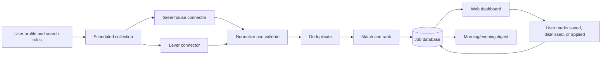

# Auto Job Application Tracker

A CIS 454 project that collects job listings from multiple approved sources,
matches them against a job-seeker profile, removes duplicates, and sends a
morning and evening report of the best new opportunities.

## Proposed MVP

The first version will let one user:

- create a profile with target titles, skills, location, work arrangement, and
  job type;
- collect public listings from Greenhouse and Lever job boards;
- normalize and deduplicate listings in one database;
- rank listings using explainable keyword and preference matching;
- review saved, dismissed, and applied jobs in a small web dashboard; and
- receive configurable morning and evening reports; and
- read job-alert emails from Gmail with one-time, read-only permission.

## Speed Mode

JobTrail is optimized for a measurable goal: apply to a qualified job within
30 minutes of detection. Direct ATS boards are checked every five minutes. A
job enters the urgent queue when it is less than two hours old and meets the
profile score threshold. JobTrail records detection, first-opened, and applied
timestamps and reports estimated source-to-detection and detection-to-application
latency.

On macOS, the running server sends a local notification for newly detected
urgent matches after the initial database seed. The notification button in the
dashboard also enables browser notifications. Both mechanisms are local and
only operate while JobTrail is running; sleeping or shutting down the laptop
pauses collection.

The MVP will **not** scrape LinkedIn or automatically submit applications.
LinkedIn's user agreement prohibits unauthorized scraping, and fully automated
application submission creates security, consent, and reliability concerns.
Those features can be reconsidered later through approved integrations and a
user-confirmed application workflow.

## Recommended stack

- **Backend:** Python, FastAPI, SQLAlchemy
- **Jobs/scheduling:** APScheduler for the class demo; Celery or a cloud job
  scheduler if the project grows
- **Database:** SQLite for local development, PostgreSQL for deployment
- **Dashboard:** server-rendered FastAPI/Jinja pages for the smallest MVP;
  React is an optional upgrade
- **Notifications:** email first, with Discord or Slack as later connectors
- **Testing:** pytest with saved API fixtures

## Core workflow



## Design documents

- [System design and technology choices](docs/SYSTEM_DESIGN.md)

## Interactive demo

The current demo runs locally because it uses Python background jobs and a
persistent SQLite database:

- Source: [`demo/`](demo/)

```bash
cd demo
python3 -m venv .venv
.venv/bin/pip install -r requirements.txt
.venv/bin/python server.py --collect-now
```

Open `http://127.0.0.1:4173`. The dashboard uses live Greenhouse and Lever
postings only—no sample jobs—and persists normalized jobs, tracking states,
profile preferences, collection runs, and schedule settings in SQLite.

## Clone and run from GitHub

On macOS or Linux, copy and run these commands exactly:

```bash
git clone https://github.com/SidKumaran975/CIS454.git
cd CIS454/demo
python3 -m venv .venv
source .venv/bin/activate
python -m pip install --upgrade pip
python -m pip install -r requirements.txt
python server.py --collect-now
```

Leave that terminal open, then visit `http://127.0.0.1:4173` in a browser.
Press `Control-C` in the terminal to stop JobTrail. On later runs:

```bash
cd CIS454/demo
source .venv/bin/activate
python server.py
```

The first run creates a new local `data/jobtrail.db`; it does not download the
developer's profile, Gmail token, résumé, or database. Gmail and local-AI
profile analysis are optional and can be configured from the profile page.

## Connect Gmail job alerts

Gmail gives JobTrail a safe way to collect LinkedIn, Glassdoor, and Handshake
alerts without trying to scrape those sites or asking you to download messages.

1. In [Google Cloud Console](https://console.cloud.google.com/), create or select
   a project and enable the Gmail API.
2. Configure the OAuth consent screen for personal testing.
3. Create an OAuth client with application type **Desktop app** and download the
   JSON file.
4. In JobTrail, open **My profile → Job alert inbox**, add that JSON file, and
   choose **Connect Gmail**.
5. Approve the read-only Gmail permission. JobTrail then checks the configured
   Gmail query every 15 minutes while the local server is running.

JobTrail first attempts to store the OAuth token in the macOS Keychain. If the
Keychain is unavailable, it uses `demo/data/google_oauth_token.json` with
owner-only file permissions. The client configuration, token, SQLite database,
uploaded documents, and saved email files must never be committed to Git.

JobTrail never marks messages read, changes labels, sends email, or deletes
anything. It stores message IDs for deduplication, email subjects and senders,
and job details extracted from matching alerts in the local SQLite database.

### LinkedIn and Handshake ingestion

JobTrail does not sign into or scrape LinkedIn or Handshake. Instead, those
services send job alerts to Gmail and JobTrail reads the alert messages. The
ingestion pipeline now:

1. accepts only job-detail links, excluding profile, feed, connection, login,
   search, unsubscribe, and preference links;
2. converts tracking-heavy links into stable canonical URLs;
3. deduplicates LinkedIn and Handshake postings by their platform job ID; and
4. stores an observation linking each job to its Gmail message and alert
   subject, so the dashboard can show which search found it.

Create Gmail filters that apply a `JobTrail` label to LinkedIn and Handshake
alerts, then use `label:JobTrail newer_than:30d` as the Gmail query. Label-only
search reduces irrelevant mail processing, although Google's OAuth permission
is still Gmail read-only at the account level.

Recommended cadence: set focused LinkedIn and Handshake alerts to daily, while
Speed Mode checks both Gmail and direct Greenhouse/Lever feeds every five
minutes. Polling Gmail does not make a provider's daily alert arrive sooner,
but it minimizes JobTrail's delay once the message arrives.

## Security and public repository boundary

Safe to publish: application source, static web assets, requirements,
documentation, and `.gitignore` files.

Keep local: `demo/data/`, `.venv/`, OAuth JSON files, tokens, SQLite files,
CVs, LinkedIn exports, `.eml` files, environment files, private keys, and logs or
screenshots containing personal information. The server listens on
`127.0.0.1`, so it is not exposed to other computers on the network by default.

## Current status

The local vertical slice includes eight live ATS sources, Gmail job-alert
ingestion, profile scoring, SQLite persistence, background collection,
twice-daily report generation, filtering, and saved/applied/dismissed tracking.
