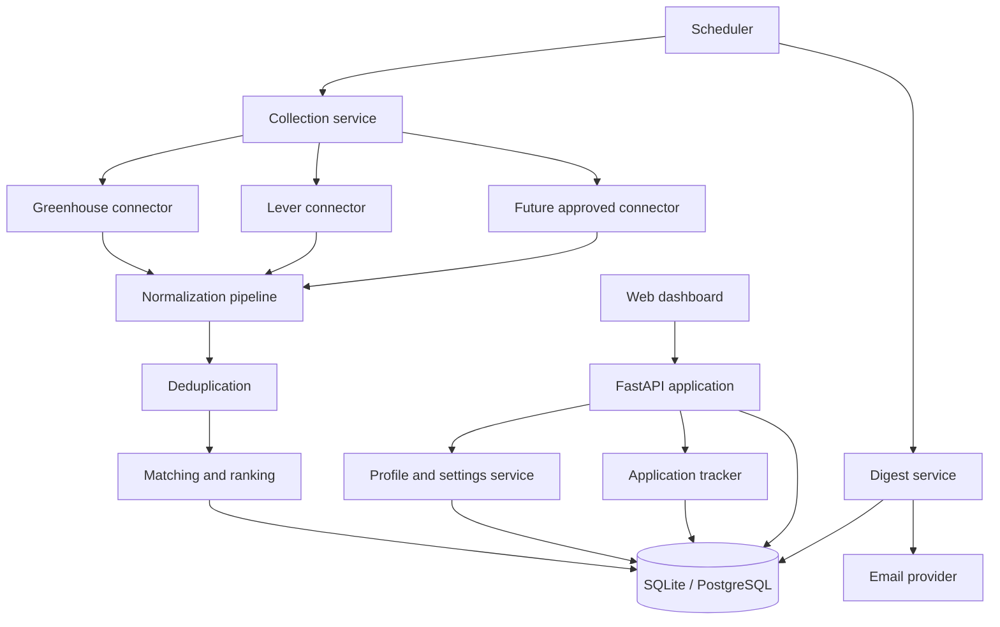
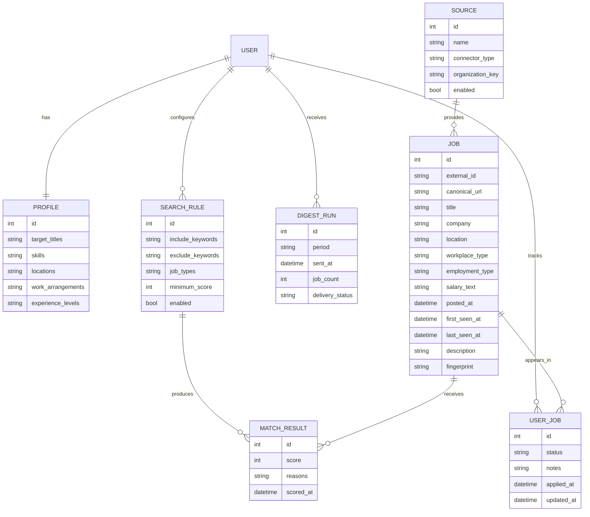

# System Design and Choices

## 1. Product goal

The Auto Job Application Tracker helps a job seeker find relevant openings
without repeatedly searching several sites. A user defines a target profile—for
example, **entry-level solutions engineer**, remote or near New York, full-time,
with Python, cloud, networking, and customer-facing skills. The system collects
new listings, scores them, and sends a concise report in the morning and evening.

The product should help the user discover and organize jobs. It should not apply
without the user's review and explicit confirmation.

## 2. User stories derived from the project description

1. **Customized profile:** Store target titles, skills, experience level,
   locations, work arrangement, job types, resume, and excluded keywords.
2. **Collect listings:** Retrieve jobs from several permitted sources on a
   schedule.
3. **Centralize data:** Show normalized listings in one searchable location.
4. **Separate position types:** Filter full-time, part-time, internship,
   contract, and co-op jobs.
5. **Configure settings:** Choose collection frequency, digest times, timezone,
   and notification channel.
6. **Track progress:** Mark a job as new, saved, dismissed, applied,
   interviewing, offered, or rejected.
7. **Assist applications later:** Pre-fill a reviewable draft only after the
   discovery and tracking workflow is stable.

## 3. Important source decision

### Recommended approach: approved APIs and public employer job boards

Start with the public Greenhouse Job Board API and Lever Postings API. They
provide structured public job data and are more stable and testable than page
scraping.

Do not build the MVP around direct LinkedIn scraping. LinkedIn's User Agreement
prohibits using crawlers, browser plug-ins, scripts, robots, or other technology
to scrape or copy its services. LinkedIn's documented Job Posting API is for
authorized partners posting jobs to LinkedIn; it is not a general job-search API.

Safe future options for LinkedIn-related discovery are:

- let users paste or import links they found themselves;
- consume user-owned alert emails with explicit permission;
- link out to a LinkedIn search for manual review; or
- use an approved partner integration if access is obtained.

### Source choices

| Choice | Advantages | Drawbacks | Recommendation |
|---|---|---|---|
| Greenhouse + Lever public APIs | Structured, reliable, easy to test, no browser automation | Searches selected employers rather than the whole internet | **Use for MVP** |
| Licensed job-search API | Broad coverage and normalized fields | API key, quotas, cost, vendor dependency | Good phase 2 option |
| Scrape arbitrary company career pages | More coverage | Fragile selectors, rate limits, terms vary by site | Add only per-site with permission |
| Scrape LinkedIn while logged in | Familiar results | Conflicts with platform rules; brittle and high account risk | **Do not use** |
| User imports links or alert emails | User-controlled and low risk | Less automatic | Useful supplement |

References:

- [Greenhouse Job Board API](https://docs.greenhouse.io/job-board)
- [Lever Postings API](https://github.com/lever/postings-api)
- [LinkedIn User Agreement](https://www.linkedin.com/legal/user-agreement)
- [LinkedIn Job Posting API overview](https://learn.microsoft.com/en-us/linkedin/talent/job-postings/api/overview)

## 4. Proposed architecture

Use a modular monolith for the class project. It is simpler to build and deploy
than microservices, while connector modules keep each job source independent.

### Component responsibilities

- **Connectors:** Retrieve source data and convert it to one internal shape.
- **Normalization:** Clean titles, locations, descriptions, URLs, salary, and
  job types.
- **Deduplication:** Prefer a source-specific ID; otherwise compare canonical
  URL, company, normalized title, and location.
- **Matcher:** Produce an explainable score and list the reasons for it.
- **Tracker:** Store user actions and application status history.
- **Digest:** Select only new, high-scoring jobs since the previous digest.
- **Dashboard:** Let the user filter, inspect, save, dismiss, and update jobs.

### Email-alert data pipeline

LinkedIn and Handshake are ingested through user-owned Gmail alerts rather than
logged-in page scraping. This is a compact three-layer data pipeline:

| Layer | Stored data | Purpose |
|---|---|---|
| Raw observations | Gmail message ID, alert subject, platform, original tracked URL, observation time | Auditing and source provenance |
| Normalized jobs | Canonical job URL, stable platform job ID, normalized listing fields | Deduplication and consistent search |
| Curated jobs | Profile score, reasons, saved/applied/dismissed state | Dashboard and morning/evening reports |

A job can have many observations because multiple alerts may find the same
posting. `job_observations` preserves that many-to-one relationship while the
`jobs` table keeps one canonical record. Gmail message IDs make ingestion
idempotent. Pagination can discover up to 500 matching messages, while raw
message downloads are processed in quota-safe batches of 30 and automatically
continued until the backlog is empty.

Scheduling follows source freshness rather than using one universal interval:

- Gmail and direct ATS boards are checked every five minutes in Speed Mode;
- LinkedIn and Handshake alerts should normally be configured as daily;
- morning/evening digests read already-normalized, scored records from SQLite.

Speed Mode defines an urgent job as a listing whose source timestamp is under
two hours old and whose score meets the profile threshold. The system records
source time, detection time, first-opened time, notification time, and applied
time. The operational target is a qualified application within 30 minutes of
detection; applicant rank is not generally exposed by the source APIs and
therefore cannot be guaranteed or measured directly.

## 5. Technology choices

### Backend

| Option | Best for | Tradeoff |
|---|---|---|
| **Python + FastAPI** | Scraping/API work, data processing, typed REST endpoints | Some frontend work still required |
| Django | Built-in admin, authentication, ORM, forms | Heavier structure for a small class MVP |
| Node.js + Express/Nest | One language across frontend and backend | Python has a stronger fit for later NLP/data work |

**Recommendation:** Python + FastAPI.

### Dashboard

| Option | Advantages | Drawbacks |
|---|---|---|
| **FastAPI + Jinja/HTMX** | Small codebase, easy deployment, enough for an MVP | Less app-like than React |
| React | Polished interactive interface and reusable components | More setup and two application layers |
| Streamlit | Fastest data-oriented prototype | Less control over product workflow and styling |

**Recommendation:** Jinja/HTMX for the class MVP. Choose React if the course
places significant weight on frontend design.

### Storage

| Option | Use |
|---|---|
| **SQLite** | Local development and the first demonstration |
| **PostgreSQL** | Hosted deployment, concurrent jobs, and reliable migrations |

Use SQLAlchemy so the application can switch without rewriting the data layer.

### Scheduling

| Option | Advantages | Drawbacks |
|---|---|---|
| **APScheduler** | Easy in-process schedules for a class demo | Not ideal with multiple server instances |
| Celery + Redis | Durable distributed background tasks | Additional infrastructure |
| Cloud scheduler + worker endpoint | Reliable and operationally simple when deployed | Provider-specific configuration |

**Recommendation:** APScheduler initially, with the collection and digest logic
written as ordinary functions so it can move to another scheduler later.

### Notifications

| Option | Advantages | Drawbacks |
|---|---|---|
| **Email** | Matches morning/evening reports and works for everyone | Requires an email provider or SMTP setup |
| Discord webhook | Very easy for a demo | Not every user uses Discord |
| Slack | Good team integration | OAuth/setup overhead |
| SMS | Highly visible | Cost and stricter consent requirements |

**Recommendation:** Email first; optionally add Discord for the classroom demo.

## 6. Data model

## 7. Matching strategy

Start with an explainable weighted score rather than an AI black box:

- title match: 35 points;
- required/preferred skill overlap: 25 points;
- location or remote preference: 15 points;
- experience-level match: 15 points;
- job-type match: 10 points;
- excluded keyword: reject or subtract a large penalty.

Example result:

> 82/100 — title contains “Solutions Engineer”; remote is allowed; 4 of 6
> preferred skills matched; entry-level language found; no excluded keywords.

Semantic/embedding matching can be an optional later experiment after a labeled
set of saved and dismissed jobs exists for evaluation.

## 8. Morning and evening digest behavior

1. Run collection before each configured digest time.
2. Normalize, deduplicate, and score new or changed jobs.
3. Select jobs above the user's minimum score that have not appeared in a
   previous successful digest.
4. Sort by score, then recency.
5. Send the top results with score reasons, location, job type, posted date, and
   an Apply/View link.
6. Record the digest so jobs are not repeatedly presented as new.

The timezone belongs to the user profile. Default digest times can be 8:00 AM
and 6:00 PM, but both must be configurable.

## 9. Security and responsible automation

- Never store job-board passwords or browser session cookies for the MVP.
- Encrypt secrets such as email API keys outside the database.
- Collect only public listing data needed by the product.
- Respect source terms, rate limits, robots directives where applicable, and
  deletion/retention requirements.
- Sanitize job-description HTML before displaying it.
- Treat resumes and profile data as private user data.
- Require a visible user review and confirmation before any future application
  submission.
- Log connector failures without logging secrets or resume contents.

## 10. MVP phases

### Phase 1 — One working vertical slice

- Profile and search-rule form
- Greenhouse connector for a configured list of employers
- Normalized jobs stored in SQLite
- Explainable scoring
- Basic jobs table with save/dismiss actions
- Manual “collect now” button

### Phase 2 — Multiple sources and scheduled reports

- Lever connector
- Cross-source deduplication
- APScheduler collection jobs
- Morning/evening email digest
- Application status tracking

### Phase 3 — Quality and deployment

- PostgreSQL and migrations
- Authentication
- Better ranking evaluation
- Connector health/status screen
- Hosted deployment and monitoring

### Phase 4 — Optional extensions

- Licensed broad-coverage job API
- User-controlled alert-email import
- Resume variants and cover-letter drafting
- Reviewable form assistance where a source explicitly permits it
- Analytics such as applications per week and response rate

## 11. Decisions needed before implementation

Choose one answer in each row:

| Decision | Recommended default | Alternatives |
|---|---|---|
| Dashboard | Jinja/HTMX | React or Streamlit |
| First sources | Greenhouse + Lever | Add a licensed API |
| Initial employer scope | 10–25 selected companies | User enters company board URLs |
| Notification | Email | Discord or both |
| Hosting | Local demo first | Render, Railway, Fly.io, or course server |
| User model | One user for MVP | Multi-user with login |
| Application automation | Track and link out | User-confirmed assistance later |

The recommended defaults produce a complete, demonstrable class project while
keeping the riskiest integrations outside the critical path.
